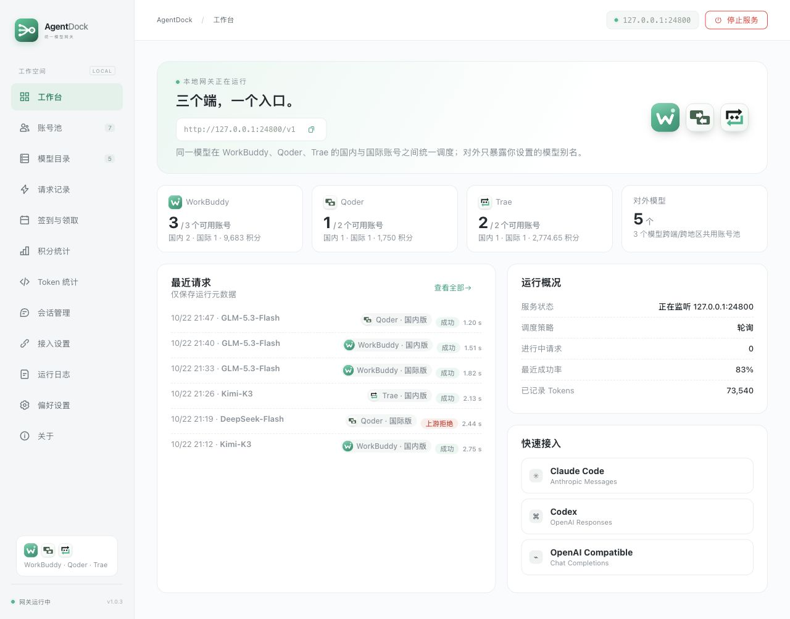
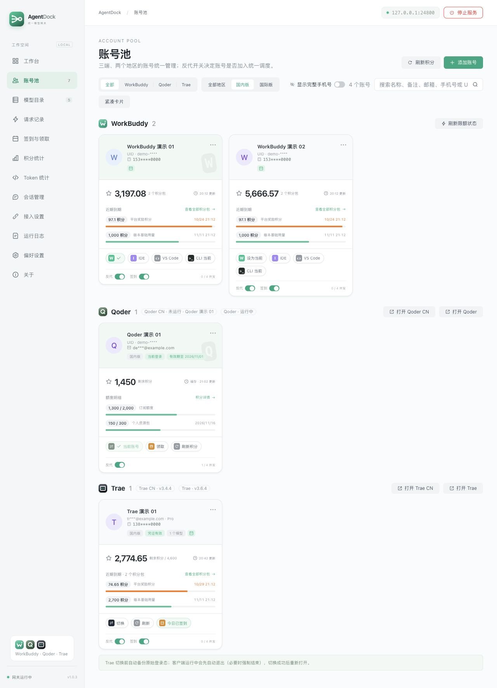
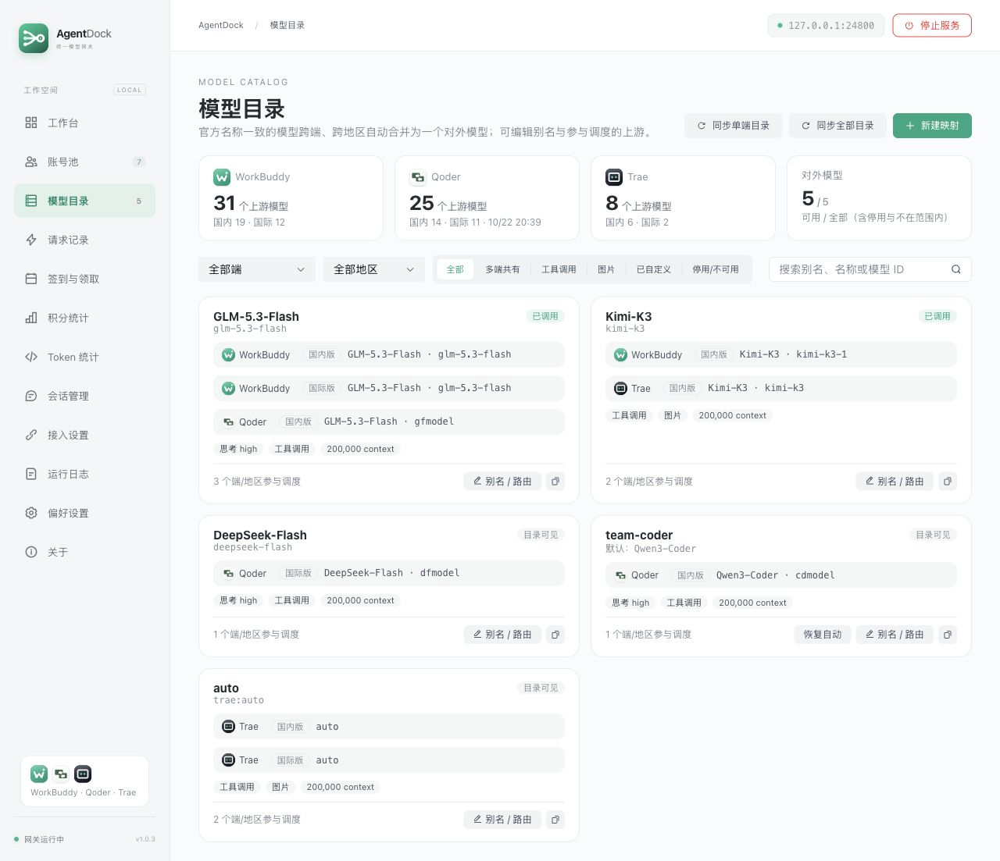
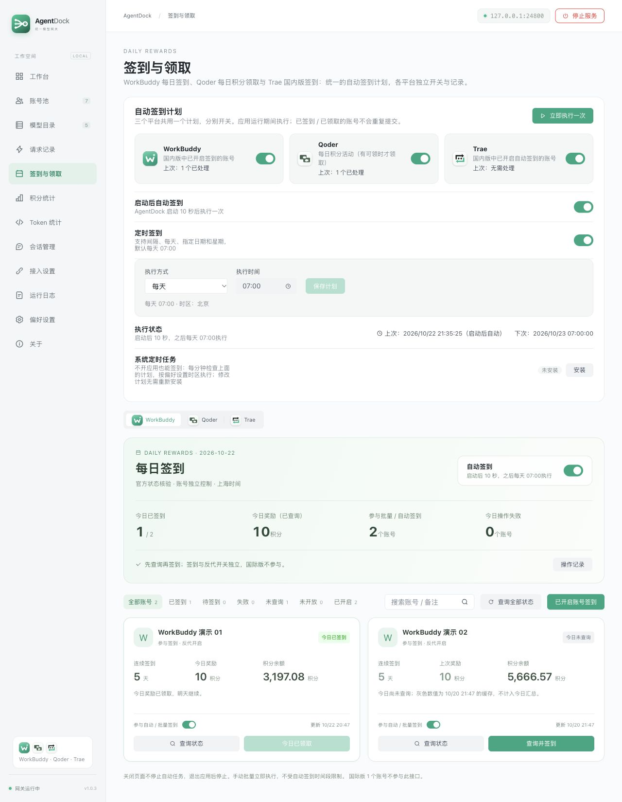
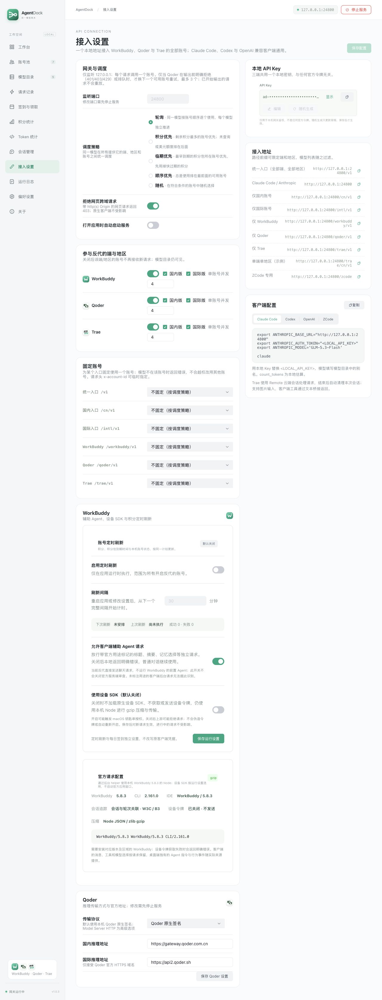
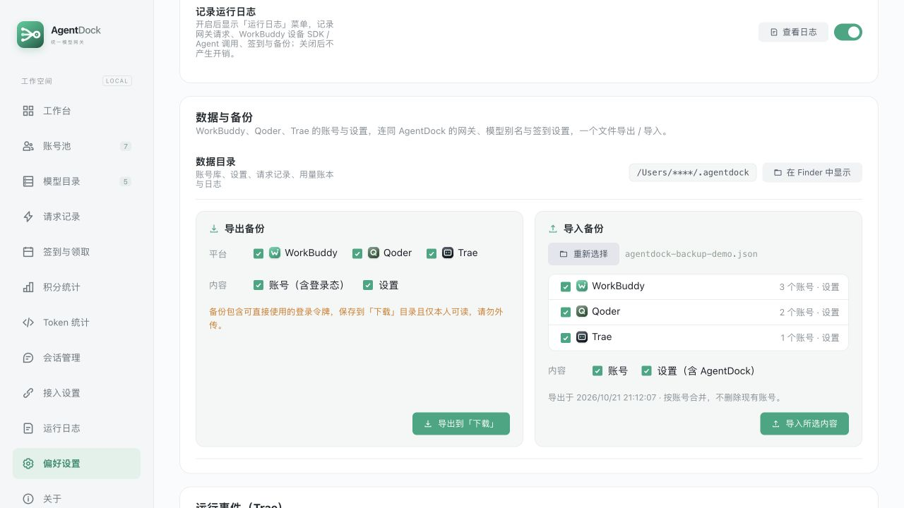

<div align="center">
  
  <h1>AgentDock</h1>
  <p><strong>三个端，一个入口。</strong></p>
  <p>WorkBuddy · Qoder · Trae 账号管理与本地模型网关</p>
  <p>
    <a href="https://github.com/AI-Good-Tool/AgentDock/releases">下载安装</a> ·
    <a href="#快速开始">快速开始</a> ·
    <a href="#界面预览">界面预览</a> ·
    <a href="https://github.com/AI-Good-Tool/AgentDock/issues">反馈问题</a>
  </p>
</div>

AgentDock 把三个平台的账号、模型、签到、会话和用量放进一个桌面工作台，通过本地地址供 Claude Code、Codex 及 OpenAI 兼容客户端使用。同一模型可在已启用的平台、地区和账号之间统一调度，对外使用你设置的模型别名。

## 能做什么

| 功能 | 说明 |
| --- | --- |
| 多平台账号池 | 统一管理 WorkBuddy、Qoder、Trae 的国内与国际账号，查看积分、凭证状态和并发占用，Qoder 积分缓存支持重启恢复，独立控制反代与签到。 |
| 统一模型目录 | 合并同名模型，支持自定义别名、路由目标、端与地区过滤，以及停用模型。实际可用模型以账号目录为准。 |
| 本地 API 网关 | 支持 Chat Completions、Responses、Anthropic Messages 三种协议，以及 ZCode 接入。 |
| 灵活调度 | 支持轮询、积分优先、临期优先、顺序优先、随机；可按入口固定账号或限制参与平台与地区。 |
| 自动签到 | 支持分钟、小时、天间隔，以及每天、指定星期、指定日期；默认每天 **07:00**，遵循偏好设置的时区。 |
| 请求与用量统计 | 查看调用账号、真实模型、协议、耗时、Token 用量与脱敏诊断；上游未提供的用量会标记为未知。 |
| 会话管理 | 提供对应平台的会话查看与管理入口，具体能力以页面及本机客户端状态为准。 |
| 偏好与备份 | 支持中英文、明暗主题、时区设置，以及账号与配置的备份、导入；选择 JSON 文件后自动预览备份内容。 |
| 应用内更新 | 检查 GitHub Releases；macOS 支持下载、SHA256 校验、安装并重启。 |

## 下载与安装

到 [Releases](https://github.com/AI-Good-Tool/AgentDock/releases) 选择对应安装包；尚未发布的构建可在 [GitHub Actions](https://github.com/AI-Good-Tool/AgentDock/actions/workflows/desktop-packages.yml) 中查看。

| 系统 | 安装包 |
| --- | --- |
| macOS · Apple Silicon（M 系列） | 文件名含 `aarch64-apple-darwin` 的 `.dmg` |
| macOS · Intel | 文件名含 `x86_64-apple-darwin` 的 `.dmg` |
| Windows · x64 | Windows `.exe` 安装包 |

macOS 打开 DMG 后，将 AgentDock 拖入 Applications。当前分发包未使用 Apple 开发者证书公证，首次打开可能需要在访达中右键选择「打开」。Windows 如出现 SmartScreen 提示，请先确认文件来自本仓库发布页。

部分推理与账号切换能力依赖本机对应平台的官方客户端；请按应用内提示安装并登录。AgentDock 安装包不包含官方 SDK、账号或密钥。

## 快速开始

1. 在「账号池」完成对应平台的登录或账号导入，确认凭证与积分状态。
2. 在「模型目录」同步目录，选择可用模型；需要时设置便于客户端使用的别名。
3. 在「接入设置」启用参与调度的平台与地区，选择调度策略。
4. 启动网关，复制接入地址和**本地 API Key**到客户端。界面提供 Claude Code、Codex、OpenAI 和 ZCode 配置示例。
5. 发起请求后，在「请求记录」检查实际使用的账号、模型和结果。

默认端口为 `24800`，可在停止网关后修改；下面的示例请以「接入设置」显示的实际地址为准。本地 API Key 用于授权 AgentDock 网关，与任何平台的官方登录令牌无关。

### 接入地址

| 使用范围 | Base URL |
| --- | --- |
| 全部已启用账号 · OpenAI 兼容客户端 | `http://127.0.0.1:24800/v1` |
| Claude Code / Anthropic Messages | `http://127.0.0.1:24800` |
| 仅国内账号 | `http://127.0.0.1:24800/cn/v1` |
| 仅国际账号 | `http://127.0.0.1:24800/intl/v1` |
| 仅某个平台 | `http://127.0.0.1:24800/workbuddy/v1`、`/qoder/v1`、`/trae/v1` |
| 指定平台与地区 | 例如 `http://127.0.0.1:24800/trae/cn/v1` |
| ZCode | `http://127.0.0.1:24800/zcode` |

模型列表随入口范围过滤。模型名填写「模型目录」中的**对外别名**；平台可用模型、图片与工具能力以目录及实际调用结果为准。

<details>
<summary>OpenAI 兼容请求示例（bash / zsh）</summary>

将 `<LOCAL_API_KEY>` 替换为本地 Key，将 `<MODEL_ALIAS>` 替换为目录中可用的模型别名：

```bash
export AGENTDOCK_API_KEY="<LOCAL_API_KEY>"

curl http://127.0.0.1:24800/v1/chat/completions \
  -H "Authorization: Bearer $AGENTDOCK_API_KEY" \
  -H "Content-Type: application/json" \
  -d '{
    "model": "<MODEL_ALIAS>",
    "messages": [{"role": "user", "content": "你好"}],
    "stream": true
  }'
```

</details>

## 界面预览

以下为 **v1.0.3 界面使用虚构数据的演示截图**，没有连接真实账号。账号名称为演示名称，手机号、邮箱和 UID 已脱敏；本地 Key 保持隐藏。积分、请求和用量数字仅用于展示布局，不代表平台额度或性能承诺。

### 工作台

一眼查看各平台账号、模型、网关状态和最近请求。



<details>
<summary>账号池：积分、凭证与独立开关（点击展开）</summary>



</details>

<details>
<summary>模型目录：跨端合并、模型别名与路由（点击展开）</summary>



</details>

<details>
<summary>签到计划：默认每天 07:00，支持多种执行方式（点击展开）</summary>



</details>

<details>
<summary>接入设置：调度策略、本地 Key 与客户端配置（点击展开）</summary>



</details>

<details>
<summary>数据与备份：选择文件后自动读取摘要（点击展开）</summary>



</details>

## 签到与更新

- **Qoder 积分缓存**：成功查询后本地保存，切换页面或重启应用后先显示缓存与查询时间；刷新失败保留上次有效额度，显示旧数据提示。首次使用需成功查询一次。
- **登录过期与自动停用**：三端账号登录过期或失效时，卡片显示红色边框与重新登录提示，历史额度标为缓存。反代请求检测到过期时间或明确鉴权失败后，会保存并关闭该账号的反代开关；重启后仍关闭，修复登录后需手动开启。普通模型权限、余额不足、限流或网络错误不会因此自动停用。
- **积分旧数据与登录失效**：WorkBuddy 积分查询收到明确的 401 或登录失效业务码时，保留上次积分作为缓存，同时标记登录失效并自动停用反代；普通网络失败仅提示旧数据。
- **重新登录恢复**：WorkBuddy 授权完成后立即更新登录状态、清除旧鉴权失败标记，并自动刷新积分；成功查询积分也可验证外部重新登录。已停用的反代保持关闭，按需手动开启。若授权了其他账号，会明确提示原账号尚未修复。
- **批量账号 JSON**：账号池可按当前平台、地区与搜索条件批量选择并导出账号。通过「导入 JSON」选择文件或粘贴内容，可一次识别多个平台；同时兼容单账号与原生账号数组。导入前检查全部记录，格式有误时不开始写入。导出文件包含登录凭据，请勿公开分享。
- **官方授权与自动续期**：WorkBuddy 授权使用对应地区的官方桌面端点，补齐客户端版本、渠道及可用的设备上下文；Token 自动续期默认开启，应用运行时每 5 分钟检查，临近到期或距上次续期满 24 小时时续期。反代和积分查询收到 HTTP 401 时，尝试续期并重试一次；流式内容已输出后不重放。网络失败保留原凭据，服务端已撤销的刷新凭据仍需重新登录。卡片上的「续期」按钮可手动续期，即使关闭自动续期也可使用；成功后刷新登录状态，已停用的反代保持关闭。
- **导入当前登录账号**：读取本机 WorkBuddy 加密登录态，按 UID 与地区更新已有账号凭据并立即刷新状态；读取失败明确报错，不退回旧账号库。原先关闭的反代保持关闭。
- **手机号查看**：优先展示官方资料中的完整号码，也支持同 UID 的 Token 所携号码；卡片和详情可显示或隐藏。手机号作为卡片标题或继承自来源工具的展示名时，同样遵循隐藏设置。若来源只有脱敏号码，明确说明无法还原；关闭详情后恢复脱敏。
- **应用内签到**：可在启动 10 秒后执行一次，也可按保存的定时计划执行；三个平台共用计划，分别开关。
- **系统定时任务**：在支持的系统上从界面安装，应用关闭后也可检查计划；修改计划后按界面提示更新旧任务。
- **在线更新**：在「关于」检查更新。macOS 确认后会下载匹配架构的安装包、校验 SHA256，再安装并重启；仅有 Actions 构建而未发布到 Releases 的版本不会出现在在线更新中。

更多实现与使用说明：[签到与应用内更新](docs/checkin-and-update.md)。

## 使用边界与隐私

- 网关仅监听 `127.0.0.1`，默认拒绝带网页 HTTP(S) Origin 的跨域请求。本地网关不等于本地模型推理，请求会发送给所选平台的上游服务。
- **Trae 使用 Remote 云端会话**，客户端工具通过文本桥接返回；请求结束、失败或取消后自动清理本次创建的云端会话，不提供本地会话模式切换。清理失败保留待办并补偿重试；网络故障、未取得会话 ID 等情况仍可能留下云端记录。[自动清理说明](docs/trae-cloud-cleanup.md)
- Responses 采用无状态兼容方式，客户端需回传完整历史；支持客户端 function、namespace 与 custom 工具映射，不支持服务端工具、`previous_response_id` 或跨提供商加密推理。Anthropic `count_tokens` 为本地估算。
- 账号调度不会替你重放已经开始输出的请求。Qoder 仅在输出前出现明确拒绝或排队等符合条件的情况时，才会尝试下一个可用账号，最多尝试 3 个账号。
- 数据默认保存在用户目录下的 `~/.agentdock`，可通过 `AGENTDOCK_HOME` 或 `--data-dir` 指定其他目录。**账号导出与备份可能包含可直接使用的登录令牌，请勿上传到公开仓库或 Issue。**
- 反馈问题时优先提供脱敏诊断；截图前隐藏手机号、邮箱、UID、本地路径、API Key 和登录凭证。README 中的图片全部来自虚构演示数据。

## 本地开发

技术栈：**Tauri 2 · Rust · Vue 3 · TypeScript · Arco Design**。

需要 Node.js、npm、Rust stable，以及对应系统的 Tauri 构建依赖；macOS 需要 Xcode Command Line Tools，Windows 需要 MSVC C++ 构建工具与 WebView2。

```bash
npm ci
npm run desktop
```

常用命令：

```bash
# 类型检查与前端生产构建
npm run build

# Rust 工作区测试
cargo test --locked --workspace --manifest-path src-tauri/Cargo.toml

# 构建桌面安装包
npm run desktop:build
```

仅浏览界面、无需真实账号时：

```bash
npm run dev
# 打开 http://127.0.0.1:1420/?preview=1&lang=zh
```

演示模式仅在开发服务中启用，使用虚构数据，不执行真实登录、签到或网关请求。

## 构建与反馈

GitHub Actions 提供 macOS Apple Silicon、macOS Intel 与 Windows x64 构建。符合工作流路径条件的分支推送会生成构建产物；推送版本标签后，发布流程会校验安装包与 SHA256，再发布至 Releases。

- [发布记录与下载](https://github.com/AI-Good-Tool/AgentDock/releases)
- [CI 构建](https://github.com/AI-Good-Tool/AgentDock/actions/workflows/desktop-packages.yml)
- [提交问题或建议](https://github.com/AI-Good-Tool/AgentDock/issues)
